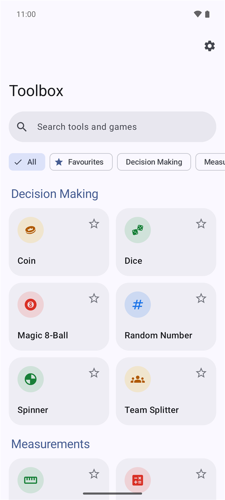
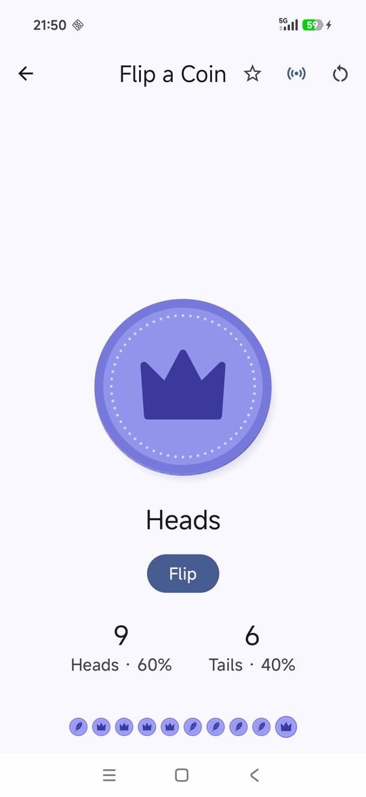
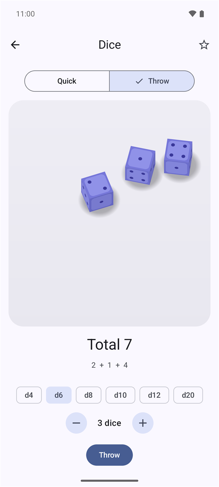
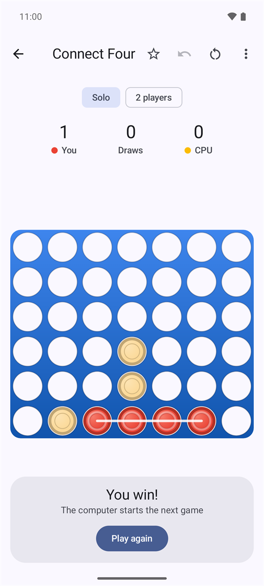
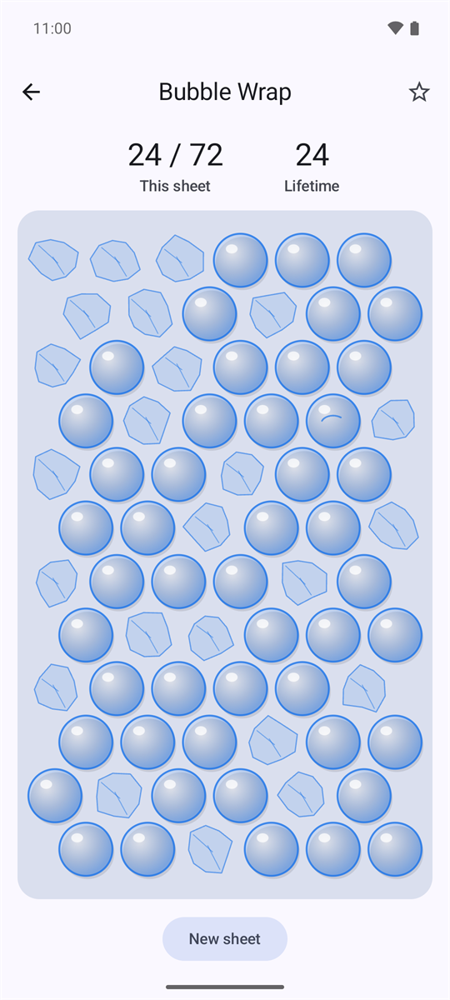

# Toolbox

Everyday tools, fidget toys and mini-games in one Android app, styled after Google's Material You. No ads, no accounts, no internet access and no third-party libraries.

**Website:** https://totallynotkasai.github.io/Toolbox/
**Download:** [latest APK](https://github.com/totallynotkasai/Toolbox/releases/latest/download/Toolbox.apk) (Android 8.0 and up)

<p align="center">
  
  
  
  
  
</p>

## What's inside

- **Decision Making:** Flip a Coin · Coin Toss (physics: swipe or shake harder to throw higher) · Roll a Die (d4–d20, up to 6 dice) · Dice Toss (physics dice on a walled table) · Spinner · Random Number · Magic 8-Ball · Team Splitter
- **Measurements:** Bubble Level · Compass · Sound Meter · Step Counter · Tally Counter · Unit Converter (UK and US measures) · Calculator · Tuner (chromatic, guitar, bass, ukulele, violin)
- **Time:** Date Calculator · Timer · Stopwatch · Metronome
- **Fidget Toys:** Meditate (guided breathing) · Fidget Spinner · Bubble Wrap · Clicky Switches · Rotary Dial · Purring Cat · Rain Stick · Zip & Ratchet
- **Solo Games:** Snake · Block Breaker · Reaction Time · Simon · Memory Game · 2048 · Lights Out · Stack Tower
- **Duo Games:** Snowman (Hangman with a melting snowman) · Tic-Tac-Toe · Connect Four · Dots and Boxes · Air Hockey · Battleships, each against the computer or another player

Search finds a tool by its name, category or keywords ("decibel" finds the Sound Meter, "north" the Compass). Star any tile to pin it under **Favourites**. Shake the phone to decide on the coins, dice, spinner, random number, 8-ball and team splitter.

## Permissions

The microphone (Tuner, Sound Meter) and physical activity (Step Counter) are asked for only when their screen first opens. The Step Counter also starts after a reboot so the day's count carries on.

## Building

Requires JDK 17 or newer and the Android SDK; the JDK bundled with Android Studio works. Open the folder in Android Studio and press Run, or:

```bash
./gradlew assembleDebug        # APK in app/build/outputs/apk/debug/
./gradlew installDebug         # install on a connected phone or emulator
./gradlew testDebugUnitTest    # unit tests
./gradlew lintDebug            # lint
```

GitHub Actions runs the unit tests and lint on every pull request.

Built with Kotlin, Jetpack Compose and Material 3 (dynamic colour on Android 12+). Pitch detection, audio synthesis, the coin and dice physics and the game AIs are all written in the app.

## Project layout

```
app/src/main/java/com/toolbox/app/
  Tools.kt        every tile, its category and search keywords (adding a tool = one entry)
  MainActivity.kt navigation and transitions
  home/           home grid, search and category chips
  ui/             theme and shared pieces (scaffold, haptics, sensors, shake, tone synth)
  tools/<name>/   one package per tool
  games/<name>/   one package per game
```

Screens stay thin: each feature's logic lives in a plain Kotlin file beside it (e.g. `Units.kt`, `CoinPhysics.kt`, `ConnectFour.kt`), and that's what the unit tests cover.

## Licence

[MIT](LICENSE)
